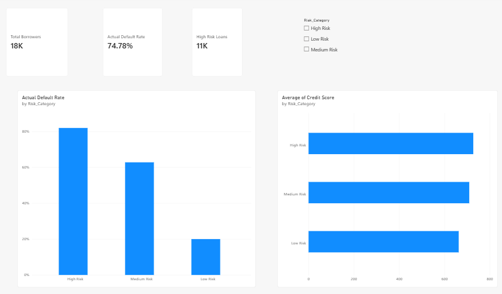

# Credit Risk & Loan Default Analytics (Python + SQL + Power BI)

## 📌 Project Overview
An end-to-end credit risk analytics and machine learning pipeline designed to predict borrower default risk, validate risk segments using SQL, and visualize portfolio exposure in Power BI.

---

## 🛠️ Tech Stack & Workflow
1. **Python (`Pandas`, `Scikit-Learn`, `Seaborn`, `Matplotlib`):** Data cleaning, anomaly correction, exploratory data analysis (EDA), and classification modeling.
2. **SQL (`SQLite`):** Portfolio cohort analysis, risk-tier validation, and high-risk applicant extraction.
3. **Power BI (`DAX`):** Interactive executive dashboard with dynamic slicers and KPI tracking.

---

## 🔍 Key Insights & Findings
* **Data Quality Resolution:** Identified and fixed corrupted `Credit Score` records inflated 10x above the valid 300–850 range before modeling.
* **Risk Segmentation:** Scored **17,957** borrowers into **Low Risk**, **Medium Risk**, and **High Risk** tiers using predicted default probabilities.
* **Model Validation via SQL & Power BI:**
  * **High Risk Tier:** Accounts for **11K** flagged loans with an actual default rate exceeding **80%**.
  * **Medium Risk Tier:** Exhibits an actual default rate of approximately **63%**.
  * **Low Risk Tier:** Drops to a **20%** actual default rate, confirming strong risk separation.

---

## 📂 Repository Structure
* `eda.ipynb` — Jupyter Notebook covering data cleaning, visualizations, model training, and probability export.
* `loan_analysis.sql` — Business validation queries and high-risk watchlist extraction.
* `loan_risk_dashboard.pbix` — Interactive Power BI Desktop report file.
* `loan_predictions_master.csv` — Scored test dataset powering the SQL database and Power BI report.
* `dashboard_preview.png` — Static preview of the final Power BI dashboard.

---

## 🚀 How to Run This Project
1. **Python Pipeline:** Open `eda.ipynb` and run all cells to clean the raw data, train the classifier, and export `loan_predictions_master.csv`.
2. **SQL Queries:** Connect `loan_portfolio.db` in VS Code (using the SQLite extension) and execute `loan_analysis.sql`.
3. **Power BI Report:** Open `loan_risk_dashboard.pbix` in Power BI Desktop to interact with the risk slicers and DAX metrics.
